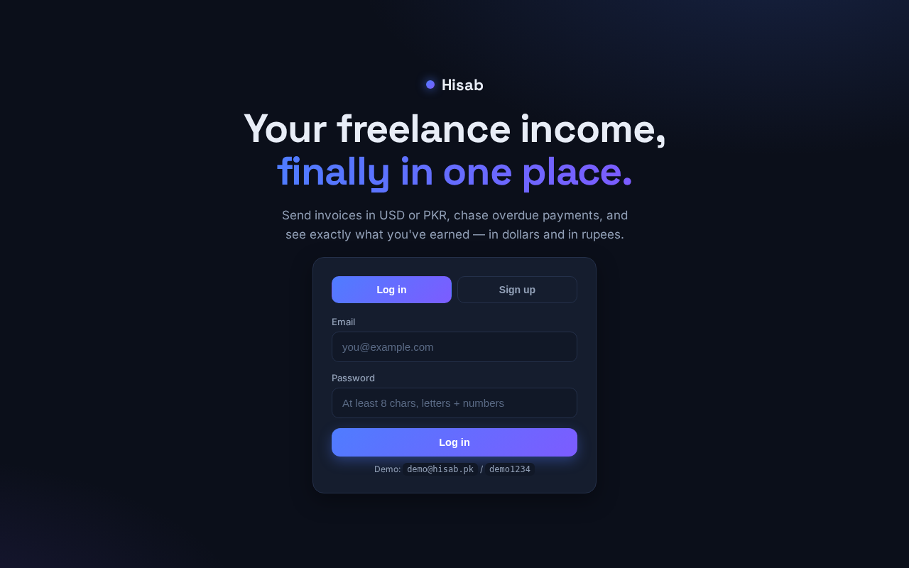
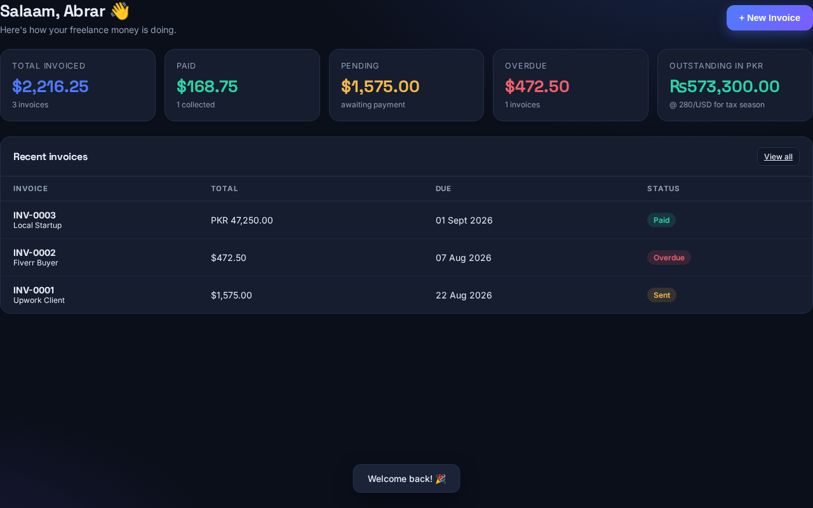
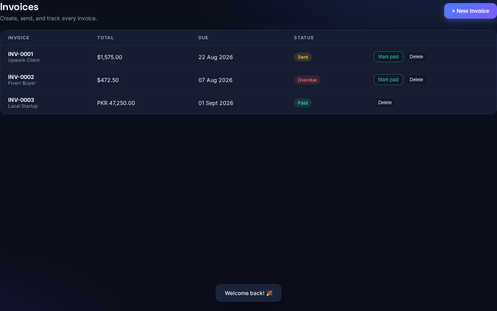

# 💼 Hisab — حســاب

**The freelancer's invoice & payment tracker.** Send invoices in USD or PKR, chase overdue
payments, and see what you've actually earned — in dollars *and* in rupees, ready for tax
season.

Built as **Day 6** of a 30-day autonomous build challenge: one production-ready full-stack
project every single day.

---

## 📸 Screenshots

| Landing | Dashboard | Invoices |
|---|---|---|
|  |  |  |

*Multi-currency income: PKR invoices are normalized to USD at the configured rate (280/USD),
and the outstanding figure is shown in rupees for tax-season planning.*

## 🚀 Live demo

**Not deployed** — this sandbox has no Vercel CLI or token, so there's no live URL yet. The
app is fully runnable locally in two commands (see [Quick start](#-quick-start-local)), and the
repo ships `vercel.json` + `api/index.py` so deployment is a single `vercel --prod` away once
a token is available.

## ✨ Features

- 🧾 **Invoices** — create with line items, currency (USD/PKR/EUR/GBP/AED/SAR), due dates and
  notes; totals + 5% tax calculated automatically; sequential numbers (`INV-0001`, …)
- 📨 **Lifecycle** — draft → sent → paid; overdue is derived automatically once the due date
  passes
- 👥 **Clients** — keep everyone you bill in one place (company, email, country)
- 📊 **Dashboard & income report** — invoiced / paid / pending / overdue in USD, plus an
  approximate **PKR figure** for FBR tax-season planning
- 🔐 **Auth** — JWT + bcrypt, owner-scoped data (you only ever see your own stuff)
- 📱 **Mobile-first SPA** — no build step, works offline-ish, dark theme
- 🐳 **Docker + PostgreSQL** — `docker compose up` for a prod-like stack, SQLite for zero-setup dev
- 🚀 **Vercel-ready** — `api/index.py` + `vercel.json` included

## 🧱 Tech stack

FastAPI · SQLAlchemy 2.0 (typed ORM) · Pydantic v2 · JWT + bcrypt · slowapi rate limiting ·
vanilla JS SPA · Docker / PostgreSQL 16 · GitHub Actions CI

## 🚀 Quick start (local)

```bash
# 1. clone & enter
git clone https://github.com/mohdabrarbaloch-arch/day-6-hisab.git
cd day-6-hisab

# 2. environment
python -m venv .venv && source .venv/bin/activate
pip install -r requirements.txt
cp .env.example .env

# 3. seed demo data (optional)
python seed.py

# 4. run
uvicorn app.main:app --reload
```

Open http://localhost:8000 — the app is served from the same port as the API.
Interactive API docs: http://localhost:8000/api/docs

**Demo login:** `demo@hisab.pk` / `demo1234` (after `python seed.py`)

## 🐳 Docker (PostgreSQL)

```bash
docker compose up --build
# API → http://localhost:8000, DB → Postgres 16 in a volume
```

## 🧪 Tests & lint

```bash
pytest          # 30+ tests
ruff check .    # lint
ruff format .   # format
```

## 🔌 API (summary)

| Method | Path | Description |
|---|---|---|
| POST | `/api/auth/register` | Create account |
| POST | `/api/auth/login` | Get JWT (OAuth2 form) |
| GET | `/api/auth/me` | Current user |
| GET/POST | `/api/clients` | List / create clients |
| GET/PUT/DELETE | `/api/clients/{id}` | Client detail / update / delete |
| GET/POST | `/api/invoices` | List (filter `?status=`) / create |
| GET | `/api/invoices/{id}` | Invoice with totals |
| POST | `/api/invoices/{id}/send` | Mark sent |
| POST | `/api/invoices/{id}/pay` | Mark paid |
| DELETE | `/api/invoices/{id}` | Delete |
| GET | `/api/stats/summary` | Income summary (USD + PKR) |
| GET | `/api/stats/dashboard` | Dashboard bundle |
| GET | `/api/health` | Health check |

Full reference: [docs/api.md](docs/api.md)

## 📁 Project layout

```
app/
  main.py            # FastAPI assembly, CORS, rate limiting, headers
  config.py          # env-driven settings
  database.py        # engine + session + Base
  models.py          # User, Client, Invoice, InvoiceItem
  schemas.py         # Pydantic contracts
  security.py        # bcrypt + JWT
  deps.py            # current-user dependency + limiter
  routers/           # auth, clients, invoices, stats
  services/          # invoice business logic
  static/            # SPA (index.html, styles.css, app.js)
api/index.py         # Vercel serverless entry
tests/               # pytest suite
docs/                # setup, usage, API reference
```

## 📄 License

MIT — see [LICENSE](LICENSE). Built by [Abrar Baloch](https://github.com/mohdabrarbaloch-arch).
